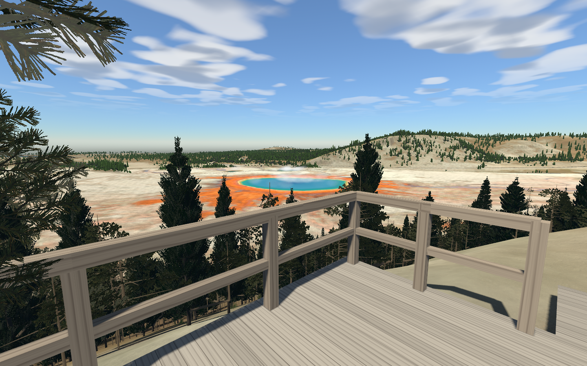
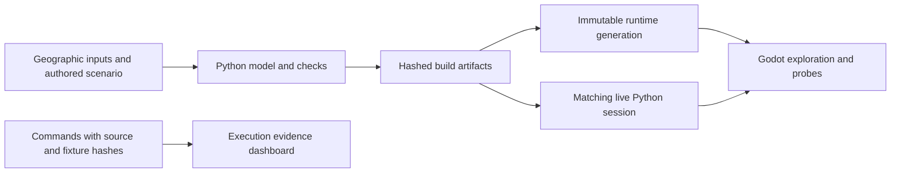

# Yellowstone Midway

A georeferenced Yellowstone environment connecting Python ecosystem models to an interactive Godot world, with traceable data and explicit model limits.



[Recorded demonstration](docs/portfolio-demo.mp4) | [Three case studies and numerical experiment](docs/PORTFOLIO.md) | [Execution evidence](evidence/receipts/) | [Model authority](docs/MODEL_AUTHORITY.md) | [Toolchain contracts](docs/TOOLCHAIN.md)

The current environment covers a 4.096 km square around Midway Geyser Basin. Roads, boardwalks, thermal features and the Firehole use geographic inputs. Python supplies river heat transport, land stocks and ecosystem trajectories; Godot renders those trajectories with walking, probes, weather, vegetation and KJR-owned animal meshes. The recorded comparison changes one authored input and shows the downstream temperature response.

The project is unfinished. Geographic inputs are measured or mapped; channel widths, underwater depths, ecological rates and many placements remain authored. Numerical checks establish selected conservation, control and execution behavior. All scientific claims remain `not_yet_accepted`; ecological forecast validation is unavailable.

## View the demo

[Download the preview package](https://github.com/seris10/yellowstone/releases/download/midway-forest-8f7ed4ee574d/Yellowstone-Forest-Spring-Update.zip). The prepared demo package contains the authored scene and one immutable runtime generation. Extract it, use Godot 4.5.1, and run:

```sh
cd Yellowstone-Forest-Spring-Update
godot --headless --editor --path . --import --quit
godot --path .
```

[Visual update and camera-framing report](https://github.com/seris10/yellowstone/releases/download/midway-forest-8f7ed4ee574d/Yellowstone-Visual-Update.html) documents the forest, spring, cloud and rain-history changes with native captures and retained limits.

Python is unnecessary for offline exploration. The local service may be unavailable. The interface shows execution mode, model time and release identity. Choose **Guided river temperature experiment** in the portfolio scenario, or begin walking. WASD walks, mouse looks, Esc opens starting places, H opens a river probe and Q pauses playback. [Controls and bake details](yellowstone_midway/README.md) describe the source checkout path.

A source checkout omits the generated authored scene. Rebuild it from the supplied world inputs before launch:

```sh
cd yellowstone_midway
godot --headless --editor --path . --import --quit
godot --headless --path . --script tools/bake_world.gd
godot --path .
```

On the tested macOS machine, use `godot --path . --rendering-method mobile --rendering-driver metal` for visible exploration and captures. [Measured render scope](docs/PERFORMANCE.md) records platform and limits.

## Reproduce the model

Use Python 3.14 with the clean reference lock. From the repository root:

```sh
cd yellowstone_python
python3.14 -m venv .venv
.venv/bin/python -m pip install -r requirements-reference.lock
.venv/bin/python -m pip install -e . --no-deps --no-build-isolation
.venv/bin/python -m pytest -m 'not needs_world' -q
.venv/bin/python -m tools.reference_run --out ../work/reference-experiment.json --plot ../work/reference-experiment.png
```

The small experiment uses synthetic geometry and fixed forcing. Full-world reproduction requires the frozen Godot inputs and canopy artifacts described in [the Python guide](yellowstone_python/README.md). Acquire any missing raw data using that guide; a local cache is separate from a reproducible input. With those inputs available:

```sh
.venv/bin/python -m yellowstone_python.build --config configs/portfolio.yaml
.venv/bin/python -m yellowstone_python.publish --build derived/<build-id> --to ../yellowstone_midway
cd ../yellowstone_midway
godot --path .
```

The publisher verifies the build manifest and bound check report, stages a complete generation, then replaces one pointer. Previous generations remain available. Starting `.venv/bin/python -m yellowstone_python.service.live --build derived/<build-id>` from `yellowstone_python/` resumes that model's initial state and forcing. A service serving another build cannot silently replace the selected generation.

## Architecture and evidence



Display lighting, model-time advance and scenario reset have separate effects. Wind-removed snow is a solid export; only liquid drainage can enter river discharge. Snow/soil ET has one owner. Playback speed leaves the river timestep unchanged. Frozen diagnostics, unavailable fields, numerical verification and empirical evaluation have distinct evidence states.

GitHub Actions defines an isolated reference path and a separate self-hosted scientific path. Local receipts report executed and skipped cases separately and become stale when source or fixture bytes change. A workflow definition alone establishes no completed GitHub run.

## Data and licensing

Repository-default code uses [Apache-2.0](LICENSE). Original Godot subtree code and authored project structures use [MIT](yellowstone_midway/LICENSE); files with explicit license records retain those records. The wildlife motion library is MIT and the Python integration is Apache-2.0. KJR owns the animal meshes and authorized their inclusion in the project release. Geometry ownership does not establish biological validation.

USGS elevation and LiDAR, USDA NAIP imagery, NPS geographic layers and field recordings, and third-party artwork retain their own source permissions. [Third-party credits](yellowstone_midway/THIRD_PARTY.md) and the release-specific `ASSET_INVENTORY.json` separate presence, runtime use, geometry checks and redistribution evidence.

## Future scope

A larger Yellowstone and other environments remain development plans. Midway's current evidence and reproducible boundaries are the portfolio focus. Whole-park streaming, ecological field validation and further visual refinement remain open work.
