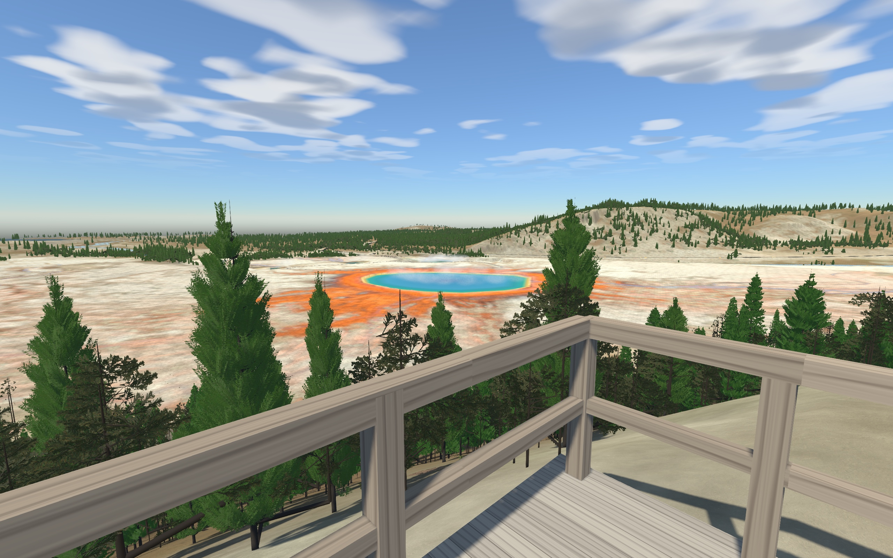
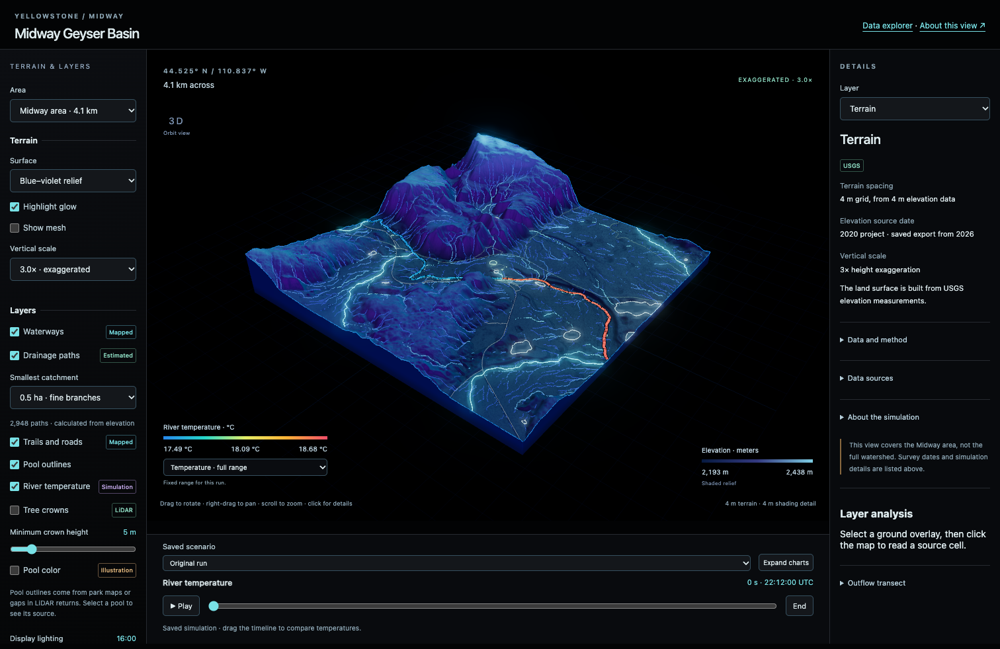

# Yellowstone

Yellowstone is a walkable Godot model of Midway Geyser Basin, with Python models of the river and surrounding land and a website for browsing their output. It is still in progress.

The scene covers 4,096 by 4,096 meters around Grand Prismatic Spring and the Firehole River: walking routes, the overlook, connected waterways, vegetation, animated wildlife, weather, and a stored river-temperature experiment. Terrain and map layers come from public data. Fine terrain edits, materials, plant shapes, wildlife motion, and some environmental inputs are hand-authored approximations.

[Data explorer](https://yellowstone-dashboard.pages.dev/dashboard/) · [3D terrain](https://yellowstone-dashboard.pages.dev/dashboard/explorer/)



## Geography and data

The terrain uses USGS 3DEP elevation from the 2020 Yellowstone QL1 project. The detailed core covers 1.28 km with a native 1 m elevation grid; the wider Midway view covers 4.096 km at 4 m spacing. Coordinates use UTM zone 12N, with heights in NAVD88.

| Layer | Source | Use in Yellowstone |
| --- | --- | --- |
| Terrain | [USGS elevation metadata](yellowstone_midway/references/dem_1m_core.tif.provenance.json) | Land surface, slopes and terrain meshes. The browser keeps the full 4 m grid and uses 2 m geometry with 1 m shading detail in the core. |
| Aerial imagery | [USDA NAIP, July 2022, native 0.6 m imagery](yellowstone_midway/references/geodata_manifest.json) | Geographic alignment and visual reference. |
| Rivers, trails and roads | [NPS Yellowstone GIS](yellowstone_midway/references/geodata_manifest.json) | Mapped paths and feature outlines. Channel widths and underwater depths are estimates. |
| Forest canopy | USGS 2020 QL1 LiDAR, 12 intersecting source tiles | A 0.5 m canopy-height raster and 34,303 detected crown cores. Detections do not identify species or count every tree. |
| River temperature | Mapped channels, transport equations and USGS observation tools | Advection, dispersion, heat exchange and scenario comparisons. Flow and upstream temperature are chosen inputs. |
| Snow and soil water | Terrain, meteorological inputs and SNOTEL observation tools | Snowmelt, infiltration, runoff and soil-water storage. |
| Thermal features | Mapped pools and published physical and biological models | Pool temperature profiles, outflow cooling, solute transport and microbial classes. |
| Vegetation and wildlife | Land cover, LiDAR, botanical literature and species records | Procedural trees, habitat responses, placement and animation. |
| Sky and sound | Bright Star Catalogue and NPS Yellowstone Sound Library | Star positions and credited environmental recordings. |

The [3D terrain explorer](https://yellowstone-dashboard.pages.dev/dashboard/explorer/) brings the terrain, mapped features and saved model results together. Click a feature to inspect its values and source. Drainage branches are calculated from the elevation grid; some may be dry gullies. Simulation results have not been validated as forecasts of current park conditions.



## Numerical and software checks

| Example | What it checks | Run it |
| --- | --- | --- |
| River transport | Mixing, conservation, refinement and restart behavior against numerical reference cases | [river_checks.py](yellowstone_python/examples/portfolio/river_checks.py) |
| Data queries | Spatial boundaries, time and cell selection, missing values and unit conversion against an independent JSON calculation | [analysis_store.py](yellowstone_python/examples/portfolio/analysis_store.py) |
| Source tracking | Changes to source files, inputs or command output invalidate a saved result record | [evidence_checks.py](yellowstone_python/examples/portfolio/evidence_checks.py) |
| Procedural trees | Repeatable branch geometry and rejection of invalid dimensions | [Tree architecture tests](yellowstone_python/tests/test_tree_architecture.py) |

These examples use small synthetic fixtures and run without Godot or network access. [Commands and expected outputs](docs/examples.md) are included. Numerical checks test the implementation; field accuracy needs separate observations.

## Standalone tools

These tools have their own installation instructions, examples and tests. They can be used separately from the Yellowstone scene.

| Repository | Purpose |
| --- | --- |
| [hydrosim](https://github.com/seris10/hydrosim) | Rainfall, infiltration and overland-flow experiments. |
| [conifer-architecture](https://github.com/seris10/conifer-architecture) | Procedural conifer branch geometry and mesh exports. |
| [fishmorph](https://github.com/seris10/fishmorph) | Fish shape modeling and mesh generation. |
| [fish-swim](https://github.com/seris10/fish-swim) | Fish swimming animation and Godot demonstrations. |
| [lidar-canopy](https://github.com/seris10/lidar-canopy) | Canopy-height rasters and crown detection from LiDAR. |
| [wildlife-motion](https://github.com/seris10/wildlife-motion) | Procedural wildlife animation and preview tools. |
| [blender-mesh-budget](https://github.com/seris10/blender-mesh-budget) | Mesh simplification with an explicit triangle budget. |
| [terrain-pages](https://github.com/seris10/terrain-pages) | Paged terrain assets and coordinate transforms. |
| [yellowstone-park-runtime](https://github.com/seris10/yellowstone-park-runtime) | Godot terrain streaming with a bundled synthetic demo. |

## Project layout

| Directory | Contents |
| --- | --- |
| `yellowstone_midway` | Godot project, shaders, assets, geographic inputs, scene authoring tools, and one checked model-data generation. |
| `yellowstone_python` | Coupled models, input preparation, numerical checks, experiment tools, and an optional local service. |
| `yellowstone_atmosphere` | Sky and weather components. |
| `hydrology` | Surface flow, infiltration, soil water, and reference checks. |
| `dashboard` | Editable website source, bundled public datasets, static site, builder, and tests. |

## Run the landscape

Running the landscape takes Godot 4.5.1 and Python 3.11 or later. Python runs once, to extract the scene, and needs only the standard library. From the repository root:

```sh
python3 yellowstone_midway/tools/unpack_scene.py
godot --headless --editor --path yellowstone_midway --import --quit
godot --path yellowstone_midway
```

The baked scene is stored compressed as `authored_world.tscn.gz` because GitHub limits file size. Extraction checks SHA-256 hashes before and after, writes the full-quality scene, and leaves a locally changed scene in place unless `--force` is given. The first import takes a few minutes. The files, the extracted scene, and Godot's import cache take about 3 GB on top of the Git history.

The Python service is optional. At startup the game looks for the local service set in `project.godot`; if it isn't running, the game plays the stored model runs. The status line shows which mode is active and the model time.

On macOS, use the Metal renderer:

```sh
godot --path yellowstone_midway --rendering-method mobile --rendering-driver metal
```

| Control | Action |
| --- | --- |
| WASD and mouse | Walk and look. |
| Shift / Space | Walk faster / hop. |
| P | Menu, starting spots, and settings. |
| Esc | Free or recapture the cursor. |
| Tab | Conditions and time controls. |
| N | Date, time, and weather. |
| `M` / `I` | Map / field notes. |
| H | River probe. |
| Q / period | Pause / step one stored frame. |
| `/` (hold) | Shortcut panel. |
| F1 | Every control. Click a key there to change it. |

Any key can be changed. Press F1, click a key, then press the new one. If the new key already belongs to another control, the two swap. Settings in the menu can show the full shortcut bar or make one press of `/` open and close the shortcut panel, and they hold mouse sensitivity, inverted vertical look, field of view, master and ambience volume, and interface scale.

The menu also starts a guided river-temperature experiment. Changing the display hour only changes the lighting; advancing model time changes the modeled state. There are no touch controls or mobile builds yet.

## Run or rebuild the website

The checked-in site can run without Godot, Python model dependencies, an API key, or a live model service:

```sh
python3 -m http.server 8000 --directory dashboard/public
```

Open `http://localhost:8000/dashboard/`. Select or zoom into a system, open a process, change time or location, and open its full dataset. The interface includes map layers, exchange filters, charts, CSV export, model results, and a separate 3D terrain page. Both views include source and method details. Its bundled values are a model snapshot; live park monitoring requires a separate feed.

Edit `dashboard/src` and rebuild into an empty output directory:

```sh
python3 dashboard/build_public.py --out work/site
python3 -m http.server 8000 --directory work/site
```

The default builder verifies the bundled dataset and image hashes. `dashboard/deploy.sh` deploys a build through Wrangler; `CLOUDFLARE_PAGES_PROJECT` and `CLOUDFLARE_PAGES_BRANCH` select the destination. Deployment requires an authorized Cloudflare account.

## Run the Python models

The reference environment uses Python 3.14.7 on macOS arm64. Package metadata allows Python 3.11 or later; other versions and platforms require their own checks. From the repository root:

```sh
cd yellowstone_python
python3.14 -m venv .venv
.venv/bin/python -m pip install -r requirements-reference.lock -e .
.venv/bin/python -m yellowstone_python.build --config configs/portfolio.yaml
.venv/bin/python -m tools.audit_provenance --dir derived
```

Each model build writes an identified output directory under `derived`. `configs/baseline.yaml` defines an illustrative baseline. `configs/portfolio.yaml` adds a prescribed river-entry temperature pulse and a comparison with otherwise matching forcing and initial conditions. Processed geographic and canopy inputs are bundled; the complete source LiDAR point clouds and all optional external datasets are not.

To publish a newly checked build to the local Godot project, replace `BUILD_ID` with its output-directory name:

```sh
.venv/bin/python -m yellowstone_python.publish --build derived/BUILD_ID --to ../yellowstone_midway
```

Publication validates artifact hashes and switches an active-generation pointer. The original bundled generation remains available. A running local model service must match the selected build and model variant.

## Checks

From `yellowstone_python`, run the complete suite:

```sh
.venv/bin/python -m pytest -q
```

From the repository root:

```sh
python3 yellowstone_midway/tools/test_scene_archive.py
godot --headless --path yellowstone_midway --script tools/validate_release_generation.gd
godot --headless --path yellowstone_midway -- --smoke-test
node --test dashboard/test_*.mjs
yellowstone_python/.venv/bin/python -m pip install -r dashboard/requirements-dev.txt
yellowstone_python/.venv/bin/python -m pytest dashboard/test_public.py dashboard/test_domain_data.py -q
```

Use a virtual environment for Python dependencies. Tests requiring optional scientific libraries or raw observations may skip when those inputs are absent. Numerical, software, and rendering checks have separate scopes; a passing software test does not establish field accuracy.

## Current limitations

- Ecological predictions have not yet been validated against independent field observations. Prescribed discharge, upstream temperature, and authored weather are inputs to scenarios. Unknown parameter uncertainty remains unknown.
- The terrain uses a local UTM coordinate frame with one Godot unit per meter. Road widths, channel-bed cuts, small drainage details, and structural dimensions include approximations. The scene's geographic extent is Midway; whole-park coverage remains outside this build.
- Canopy placement combines processed LiDAR and authored interpretation. Local crown measurements, species assignments, plant detail, and wildlife biomechanics still require independent validation.
- Tree appearance and distance transitions need further work. Some crown shapes, exposed stems, and transitions remain visibly approximate.
- Performance remains unfinished. The current dense scene ran at roughly 20 frames per second in the measured M4 Metal views; the 30 FPS target was not met. Those measurements do not establish performance on other hardware.
- The game is a desktop landscape and simulation project. Quests, inventory, progression, and a complete game loop are not implemented. Physical mobile devices, Safari, and screen-reader behavior have not been verified for the website.

## Sources and licensing

The Python project uses [Apache-2.0](LICENSE). Original Godot project code and authoring work use the [Midway MIT license](yellowstone_midway/LICENSE), except where an individual file or asset specifies other terms. The [wildlife motion library](yellowstone_python/yellowstone_python/wildlife_motion/LICENSE) retains its MIT notice. Dependencies retain their own licenses.

Animal meshes are owned by KJR and included with permission. Inclusion does not grant a blanket open license to those meshes. Per-file source, modification, license, and ownership records are retained in [asset_manifest.json](yellowstone_midway/data/asset_manifest.json). Dataset and asset licenses are separate from the code licenses.

Included Poly Haven artwork uses [CC0 1.0](https://creativecommons.org/publicdomain/zero/1.0/):

| Source | Creator credit |
| --- | --- |
| [Pine Bark](https://polyhaven.com/a/pine_bark) | Dimitrios Savva / Poly Haven. |
| [Forest Ground 04](https://polyhaven.com/a/forest_ground_04) | Rob Tuytel and Rico Cilliers / Poly Haven. |
| [Rock Boulder Dry](https://polyhaven.com/a/rock_boulder_dry) | Dimitrios Savva and Rico Cilliers / Poly Haven. |
| [Pine Tree 01](https://polyhaven.com/a/pine_tree_01) | Rico Cilliers and Rob Tuytel / Poly Haven. |
| [Grass Medium 01](https://polyhaven.com/a/grass_medium_01) | Rico Cilliers and Rob Tuytel / Poly Haven. |

Project derivatives include reduced geometry, foliage cards, texture-channel repacking, and distant views. Generic pine and grass source labels do not establish local species identity.

Geographic sources include USGS 3DEP elevation, USDA NAIP 2022 imagery distributed through USGS, and National Park Service Yellowstone roads, trails, hydrography, land cover, soils, and points of interest. These U.S. government source data are public domain. Reprojection, resampling, local offsets, terrain edits, and derived placement layers are project modifications. Source dates, service identifiers, credits, and transformations are retained in [geodata_manifest.json](yellowstone_midway/references/geodata_manifest.json) and the accompanying metadata. No claim is made to original U.S. government works, and agency attribution does not imply endorsement.

The public-domain [NPS Yellowstone Sound Library](https://www.nps.gov/yell/learn/photosmultimedia/soundlibrary.htm) supplies the Geyser Hill water and birds recordings and Lower Geyser Basin wind recording by NPS/Peter Comley, and the Firehole American Dipper and Canada Geese recording by NPS and MSU Acoustic Atlas/Jennifer Jerrett. Playback uses project-selected gain, looping, and placement; the original recording locations and dates remain in the asset metadata.

The Bright Star Catalogue retains its [source ReadMe](yellowstone_midway/references/bsc5_ReadMe.txt). Model equations, parameter sources, input hashes, units, and acceptance status remain in the registries and machine-readable data records.
