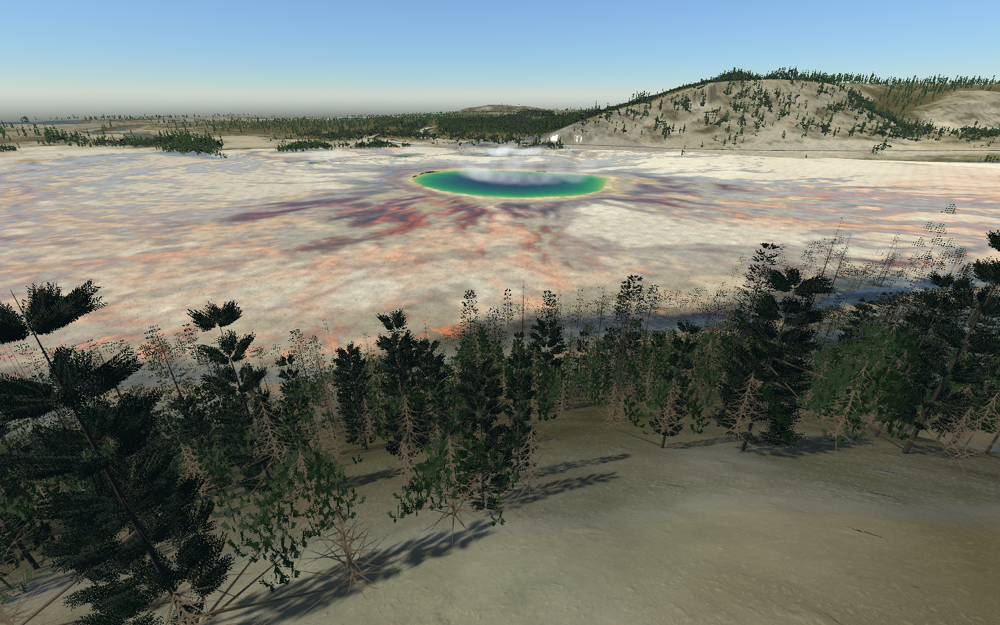
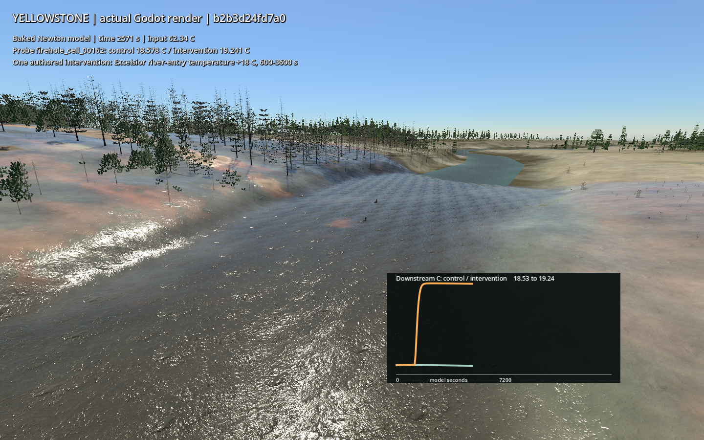
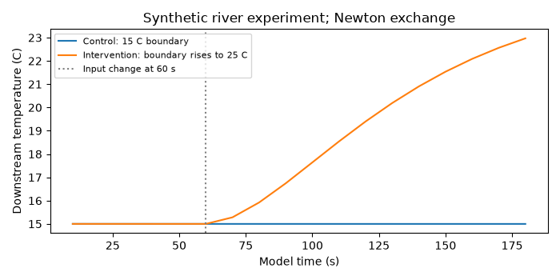

# Yellowstone Midway: current evidence

[72-second recorded demonstration](portfolio-demo.mp4) shows the thermal boardwalk, geographic source map, a mapped river probe, one frozen temperature intervention and its downstream plot. The camera route, model date, wind seed, checked comparison and release identity are recorded in the capture receipt. It uses actual Godot frames.

The surface display connects residual canopy through authored supports, adds metric ground relief and mapped basin detail, and binds linear-light spring optics from the selected generation. Clear skies use the physical sky without an added gray fog veil. Distant tree variants share batches while preserving their original view images. [Surface methods and reproduction](../yellowstone_midway/docs/SURFACE_RENDERING.md) and [executed surface evidence](../evidence/surface-rendering.json) distinguish source geography, authored display parameters, numerical checks, and native rendering.

## Geographic reconstruction

The domain is 4096 by 4096 m. One Godot unit is one metre. Coordinates use EPSG:32612 with origin E=512952.5950985841, N=4930199.044097667 and vertical offset 2200 m, NAVD88. Source-to-world conversion is `x=E-E0`, `z=N0-N`, `y=elevation-2200`. The elevation grid is 1025 by 1025 at 4 m spacing. USGS source coverage is from 2020; the selected USDA NAIP imagery was acquired July 19, 2022.

The registration command checks finite terrain, fixed metric extent, route/river joins, downstream water ordering and preserved source files. Its receipt reports the actual outcome. Original source elevation stays separate from road grading, bridge/support edits and authored water-bed cuts. A zero join error establishes continuity in those vectors; it does not establish survey accuracy or measured bathymetry.

[Geographic source records](../yellowstone_midway/docs/geography-research.md) preserve the acquisition details and agency credits. [Source model authority](MODEL_AUTHORITY.md) identifies which downstream quantities are simulated, mapped or diagnostic.

## River-model experiment

The portfolio build fixes June 21, 2026 at 22:12 UTC, wind seed 11, Newton surface exchange, 1 s solver steps and 10 s output samples. The only intervention is an authored +18 C pulse in `excelsior_aggregate_outflow` river-entry temperature from model seconds 600 to 3600. Discharge, cells, initial equilibrium temperatures and all other forcing remain fixed. The control is reconstructed by removing that pulse from the resolved solver configuration.

The selected downstream cell and every plotted value are in the generation's checked `portfolio_comparison.json`. The comparison requires identical preintervention trajectories within 1e-11 C, a downstream response, heat-budget closure and water residual below 1e-12. Synthetic tests cover Newton and explicit budgets, time-varying forcing and multiple playback speeds. Conservation and parity establish numerical behavior; they do not establish environmental forecast accuracy. Channel depth, width, roughness and boundary conditions limit physical interpretation.

The corrected snow failure is an independent negative control: 100 mm SWE at -10 C, no rain or melt, soil below drainage capacity and 15 percent daily wind loss yields 15 mm solid export and zero liquid runoff. A previous zero mass residual was insufficient because the phase label was wrong. The blowing-snow distinction is also supported by [Pomeroy and Li (2000)](https://agupubs.onlinelibrary.wiley.com/doi/abs/10.1029/2000JD900149).

The compact command in the root guide reproduces the separate synthetic experiment without full-world inputs. Its geometry and intervention differ from the mapped portfolio scenario and are labeled accordingly.

## Forest reconstruction

The LiDAR canopy input is a 0.5 m height raster covering the 1280 m core. Delivered QL1 tiles span September 29 to October 9, 2020. The geographic review imagery is from 2022. Missing support remains missing; mapped mineral, river and pool-apron surfaces are excluded from canopy interpretation.

Height-dependent local peaks produce inferred dominant-crown centers. Watershed/nearest-peak agreement defines crown cores; core radius is separate from full crown width. Ten-metre coverage cells retain measured canopy support independently of render-crown overlap. Seeded branch geometry and transferred TreeMap donor dimensions produce render geometry, with local error unavailable. LiDAR does not establish species or total/subcanopy stem counts.

The frozen [blind evaluation record](../evidence/forest-validation.json) contains **0 submitted validation plots and 0 reference labels**. Evaluation metrics are unavailable. No precision, recall, local DBH accuracy or biological validation is claimed. Crown inference, unresolved support and render meshes retain separate records in the source workflow.

## Release scope and limits

The prepared package identifies the base commit, source-content identity, model variant, scenario, selected generation and exact file hashes. KJR owns the animal meshes and authorized project release inclusion. Per-file decisions distinguish geometry permissions, runtime use and unaccepted scientific status.

The reference platform is macOS arm64 with Godot 4.5.1. Capture/performance receipts identify renderer, resolution, shadow preset, startup scope and frame-time sample. Recording overhead is separate from exploration timing. Other desktop platforms and native executable exports remain untested. No unmeasured frame-rate target or ecological acceptance is asserted.

The existing-toolchain follow-up records source/display distributions, selected graph export, real animal deformation diagnostics and native LOD captures in [the toolchain guide](TOOLCHAIN.md). Far-tree transitions and selected animal deformation limits remain unaccepted. Human anatomical review is unavailable.
