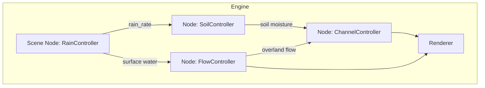
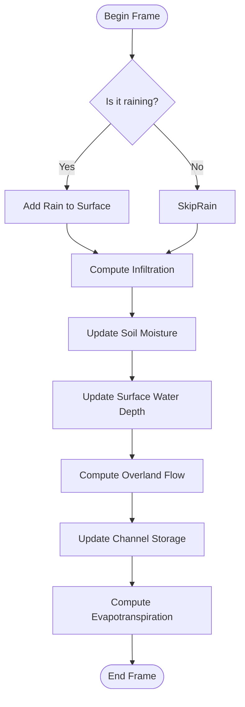

# Executive Summary 
A real-time sliding-scale rainfall system in Godot/Python can be grounded in standard hydrology and atmospheric physics. Rainfall generation can be modeled via simplified cloud/precipitation processes or stochastic space–time fields (e.g. Poisson cluster models) that yield realistic intensity and drop-size distributions. Infiltration into soil may use empirical models (Horton or Initial/Continuous Loss) or physically-based Green–Ampt (GA), balancing fidelity vs. cost. Surface runoff can be handled by kinematic-wave approximations or depth-averaged shallow-water (Saint-Venant) equations; channel routing by simple reservoir or Muskingum-type schemes. A water-balance (`rainfall – evapotranspiration – runoff = ∆storage`) closes the system. Soil moisture evolves via a “bucket” model (absorption and percolation), with evapotranspiration (ET) computed by, e.g., the Penman–Monteith equation. Root–water uptake and groundwater exchanges provide simple ecohydrological feedback. 

Numerically, real-time demands sub-second time steps and moderate-resolution grids. Explicit schemes (finite-volume or finite-difference on a regular grid) require CFL-limited dt (e.g. dt < dx/√(gH) for 2D flows), while Lagrangian particles or hybrid methods can trade off accuracy/performance. Typical parameters vary widely: e.g. Green–Ampt soil suction ψ≈50–300 mm, conductivity K≈0.3–120 mm/h; Horton f₀≈25–250 mm/h, k≈0.5–5 h⁻¹. Performance budgets (e.g. 60 fps) and GPU use (compute shaders for bulk updates) must be considered. 

In Godot, one can use the [godot-python](https://github.com/touilleMan/godot-python) GDNative plugin to script in Python. Data structures might include 2D arrays or textures for water depth, soil moisture, etc. The update loop (Physics process) adds rainfall water each frame, computes infiltration (reducing surface water, increasing soil moisture), updates overland flow (diffusing water across cells), applies channel routing, and handles ET/root uptake. Visualization uses interpolated height fields or meshes. Algorithms should be explicit and continuous (no disjoint phases), with careful timestep control. 

Validation involves comparing simple cases (e.g. constant rain infiltration vs. GA/Horton analytic solutions, dam-break hydrographs) and sensitivity runs. Simplifications (single-layer soil, ignoring groundwater, precomputed ET lookup) can greatly speed performance with modest accuracy loss. The design must balance realism vs. speed: tables below compare key models (accuracy, complexity) and list typical parameter ranges/recommended defaults. 

```mermaid
flowchart LR
    A[Atmospheric Rain Input] --> B{Infiltration Model}
    B --> C[Soil Moisture Storage] 
    A --> D[Surface Ponding] 
    D --> E[Overland Flow Solver (SWE/Kinematic)]
    C --> F[Evapotranspiration (Penman–Monteith)] 
    C --> G[Groundwater Recharge] 
    G --> H[Channel Baseflow]
    E --> H
    F --> End[(Water Vapor)] 
    H --> End 
```

## Rainfall Generation and Statistics 
Rainfall intensity and pattern can be prescribed or stochastically generated. Physically, precipitation arises from atmospheric moisture condensation (beyond real-time scope), so games often use prescribed or random rain fields. Stochastic rainfall models (e.g. Poisson cluster or point-process generators) can mimic realistic spatio-temporal fields. For example, temporal rain sequences may be generated by a cluster of random “storms” each with internal pulse structure. Spatially, rain intensity might follow an exponential or gamma distribution over area. Raindrop sizes typically follow an exponential “Marshall–Palmer” distribution (large drops rarer than small), with diameters 0.5–5 mm; terminal velocity grows roughly with diameter (≈9–10 m/s for ∼2 mm drop). These microphysical details affect splash erosion, but can often be abstracted: one may assume uniform rain flux or add variability via noise. 

**Stochastic rainfall example:** A simple model places rain cells randomly (Poisson) in time/space, with a specified probability per grid cell per timestep. Each active cell contributes water depth = intensity×dt. Alternately, use a precomputed rainfall map (texture) modulated by a global “rain rate” slider. Modern hydrology often fits rainfall intensity distributions to Gamma or Weibull families, but in real-time one typically lets user adjust “rain rate” continuously. The variability and intermittency of rain can be tuned by storm duration and frequency parameters. 

## Infiltration Models 
When rain falls on soil, part infiltrates. **Green–Ampt (GA)** is a sharp-front model: infiltration rate 
\(f(t)=K\bigl(1+\frac{\psi\,\Delta\theta}{F(t)}\bigr)\), 
where \(K\) is saturated conductivity, \(\psi\) capillary suction, \(\Delta\theta\) initial moisture deficit, and \(F\) cumulative infiltrated depth. It decays naturally from an infinite initial rate (theoretically) down to \(K\). GA is physically-based (parameters tied to soil) and suits single, continuous events (no handling of dry gaps or ET). In practice one sets an initial small “ponding time” to start the GA curve. 

**Horton’s equation** is empirical: 
\(f(t)=f_c+(f_0-f_c)e^{-kt}\), 
where \(f_0\) (initial rate) > \(f_c\) (ultimate rate ≈ saturated K) and \(k\) is a decay constant. Horton gives infiltration *capacity* over time; actual infiltration is min(capacity, rainfall). Parameters are fit from data. Typical ranges are very broad: \(f_0\approx25–250\) mm/hr, \(f_c\approx0–25\) mm/hr, \(k\approx0.5–5\) h⁻¹. Horton is simple to implement (one exponential) but ignores soil moisture feedback. 

**Richards’ equation** (unsaturated flow PDE) is most general but computationally heavy. It couples Darcy’s law with continuity: 
\(\partial\theta/\partial t=\nabla\cdot[K(h)(\nabla h+\nabla z)] - S\).  Solving Richards’ equation in real time (especially 3D) is impractical. Instead, simpler models (GA/Horton) are used. 

**Model comparisons:** GA yields realistic decline without tuning of a decay constant, and its parameters (ψ,K,porosity) have known soil ranges. Horton is easy to calibrate by experiment but less physically interpretable. For a very fast gameplay approximation, one could skip infiltration (all water goes to runoff) or fix an infiltration rate. Otherwise, using GA (with a lookup table of typical ψ and K for soil types) or Horton (with chosen \(f_0,f_c,k\)) is advisable. 

| Model        | Key Feature                                    | Accuracy   | Complexity | Typical Use       |
| ------------ | ---------------------------------------------- | ---------- | ---------- | ----------------- |
| Green–Ampt    | Physics-based wetting-front (sharp front)     | High (event)  | Moderate   | Detailed infiltration, known soils |
| Horton       | Exponential decay of infiltration capacity    | Medium     | Low        | Simplified infiltration (easy cal.)  |
| Richards Eq. | PDE for unsat. flow                            | Very high  | Very high  | Research/Numerical analysis         |
| Initial Loss (IL/CN) | Single cumulative loss depth (e.g. Curve Number) | Low   | Very Low  | Lumped hydrology, precipitation excess |

**Parameter ranges:** Soil data indicate capillary suctions ψ∼50–300 mm, K∼0.3–120 mm/hr, porosity ∼0.31–0.49. Horton’s \(f_0\)∼25–250 mm/hr, \(f_c\)∼0–25 mm/hr, \(k\)∼0.5–5 h⁻¹. For real-time defaults, one might pick medium values (e.g. ψ≈150 mm, K≈10 mm/hr for loam; \(f_0\)≈100 mm/hr, \(f_c\)≈5 mm/hr, \(k\)≈1 h⁻¹) and let users adjust. 

```markdown
| Parameter (Infiltration)     | Typical Range         |
|------------------------------|-----------------------|
| Suction ψ (Green–Ampt)       | 50–300 mm |
| Ksat (Green–Ampt)            | 0.3–117.8 mm/hr |
| Porosity (Green–Ampt)        | 0.31–0.49 |
| f₀ (Horton)                 | 25–250 mm/hr |
| f_c (Horton)                | <1–25 mm/hr |
| k (Horton)                  | 0.5–5 h⁻¹ |
```

## Overland Flow and Surface Runoff 
Water that does not infiltrate becomes surface runoff. Two main approaches model this: **kinematic wave** and **shallow-water equations (SWE)**. The kinematic-wave model simplifies flow as a moving wedge: continuity \(\partial h/\partial t + \partial q/\partial x = i\) (rain input \(i\)) coupled with a flow relation (e.g. \(q=εh^mS^n\) via Manning’s or Chezy’s law). It neglects pressure/inertia, so it’s valid on mild slopes and subcritical flow. Its advantage is speed: the PDE reduces to a first-order wave equation. 

The full 2D Saint-Venant (shallow-water) equations include momentum: 
\[
\frac{\partial h}{\partial t} + \nabla\cdot (h\mathbf{v}) = i,\quad
\frac{\partial (h\mathbf{v})}{\partial t} + \nabla\cdot (h\mathbf{v}\otimes \mathbf{v}) + gh\nabla h = gh\nabla z - \tau_b
\]
where \(h\) is water depth, \(\mathbf{v}\) velocity, \(z\) bed elevation, and \(\tau_b\) friction (often via Manning’s \(S_f = n^2 q^2/(h^{10/3})\)). Solving SWE (even in 1D channels) requires implicit or small explicit timesteps (CFL-limited: \(dt < dx/(|\mathbf{v}| + \sqrt{gh})\)). 

**Overland implementation:** For a raster (grid) terrain, one can solve 2D SWE explicitly (e.g. finite volumes) at each timestep. This is accurate but CPU/GPU intensive. A simpler alternative is the **diffusive-wave** or **kinematic wave** approximation (drop inertial term). Many game implementations use cellular automata or height-map diffusion heuristics to mimic overland flow cheaply. For example, a “sandpile” method where each cell passes excess water to downslope neighbors yields a realistic look without solving PDEs. 

**Channel routing:** If the terrain has defined stream channels, one can route flow into them. At minimum, direct excess water from grid cells into a 1D channel network node. More advanced: use a 1D Saint-Venant solver or linear reservoir (e.g. Muskingum) per channel segment. Given real-time needs, often a simplified “river stage” solved by a linear reservoir (i.e. baseflow proportional to upstream stored water) suffices. 

| Model                | Accuracy     | Performance     | Complexity  | Notes |
| -------------------- | ------------ | --------------- | ----------- | ----- |
| Kinematic wave       | Moderate     | High            | Moderate    | Good for gentle slopes; ignores inertia |
| 2D Shallow Water     | High         | Low             | High        | Realistic; requires small dt (CFL) or GPU |
| Diffusive-wave       | Moderate     | Medium          | Medium      | Keeps pressure, drops acceleration term |
| Cell-automaton (CA)  | Low–Med      | Very High       | Low         | Rule-based flow (fast, artistic) |
| Muskingum routing    | Low–Med      | High            | Low         | Lumped channel; ignores spatial detail |

In Godot, one could implement a shallow-water solver on a 2D grid (e.g. storing water height and velocity vectors in arrays) and update it each frame with finite differences. Alternatively, use a compute shader (Godot 4+) to run the water spread in parallel on GPU. For simpler scenes, a heightfield distortion via “flow maps” or even animated normal maps (e.g. Flow-map method) can represent water movement visually with minimal physics.

## Soil Moisture, Evapotranspiration, and Ecohydrology 
The subsurface “soil bucket” holds moisture that plants use and that can percolate to groundwater. We track a soil moisture variable \(S\) per cell (depth of water in root zone). The budget: incoming infiltration increases \(S\), while ET and percolation decrease it. **Evapotranspiration** can be modeled by the Penman–Monteith formula, which relates ET to net radiation \(R_n\), temperature \(T\), humidity deficit \(\delta e\), and wind \(u\). The FAO-56 Penman–Monteith reference ET0 (mm/day) is: 

\[
ET_0=\frac{0.408\,\Delta(R_n - G) + \gamma\frac{900}{T}u_2\,\delta e}{\Delta+\gamma(1+0.34u_2)},
\]

where \(\Delta\) is the slope of saturation vapor pressure curve, \(\gamma\) the psychrometric constant, \(u_2\) wind at 2 m, etc..  (In practice, one can simplify: e.g. assume constant net radiation and use vegetation coefficients \(K_c\)). ET can be limited by soil moisture: if \(S\) is low, ET is reduced (stressed plants). For simplicity, use a linear bucket: if \(S<\) a threshold, reduce ET proportionally. 

**Groundwater exchange:** A fraction of deep infiltration per timestep can enter a “groundwater” storage and slowly feed baseflow to channels. This can be modeled as a linear reservoir (e.g. \(Q_b = k_g\,G\), where \(G\) is groundwater depth, \(k_g\) a baseflow coefficient). Very coarse approaches simply let any infiltration beyond root zone run off later as delayed flow. 

**Ecohydrology:** Vegetation response can be as simple as having a stomatal resistance or crop coefficient \(K_c\) that scales ET. In real-time systems, you might encode: if \(S\) falls below 50% of field capacity, reduce transpiration. The coupling of water and vegetation can also affect surface roughness (e.g. wet vegetation slows runoff) or leaf-area-index modifying ET, but these are advanced features beyond core real-time needs. 

## Numerical Scales, Stability, and Discretization 
**Temporal scales:** Real-time games run at ~30–60 fps (dt ~0.016–0.033 s). Processes like overland flow may demand even smaller internal dt for stability (sub-10 ms). Seasonal hydrology is far beyond real-time scope; simulations must approximate long-term trends through parameter choices (e.g. averaged ET). For rainfall-runoff, the key dynamics happen from seconds (flash floods) to hours (river routing). 

**Spatial scales:** Domain size is open. A small watershed (<1 km²) with meter-scale resolution is plausible in a game. Larger domains (>10 km) require coarser resolution (tens of meters) or multiresolution techniques. Overland flow models need grid spacing (dx) small enough to capture terrain variation and ensure CFL stability. For example, with \(h=0.1\) m and \(g=9.8\), \(\sqrt{gh}≈1\) m/s; then explicit dt≈dx/1. For dx=1 m, dt≈1 s; for dx=0.1 m, dt≈0.1 s. Many real-time sims thus use dx~1–5 m. 

**Numerical stability:** Explicit depth-averaged solvers must satisfy CFL: 
\[
dt < \frac{dx}{|\mathbf{v}| + \sqrt{g h}}.
\]
For a typical shallow-water solver, this means very small dt if h is large or slope steep. Implicit solvers avoid this but are expensive. For real-time, one may accept some numerical diffusion or use lower-order schemes. The kit of methods includes: (a) **Eulerian grid** (finite-volume/finite-diff), (b) **Lagrangian particles** (SPH-like raindrops, or “water droplets”), or (c) **hybrid** (particles for small-scale splash and grid for bulk flow). Grids are simpler and map well to textures. 

| Discretization | Pros                                | Cons                               |
| -------------- | ----------------------------------- | ---------------------------------- |
| Grid (Eulerian)| Simple arrays, easy neighbor access  | CFL limits, can smear sharp fronts |
| Particles      | No CFL, detailed splash/wavefronts  | Hard to handle volume conservation, more complex data |
| Hybrid         | Can use grid + some particles (e.g. for diffusion) | More coding complexity |

In practice, a uniform grid with fixed dt (tied to target FPS) plus maybe subcycling is common. Godot allows fixed-update physics loops (`_physics_process`) which can run multiple sub-steps each frame if needed. GPU compute-shaders (available in Godot 4) can massively parallelize grid updates, but require writing GLSL code and careful data transfer.

## Mapping to Godot and Python 
Godot (4.x) is a modern open-source engine that natively uses GDScript (Python-like), C#, or C++. The [godot-python](https://github.com/touilleMan/godot-python) plugin embeds CPython via GDNative, allowing game logic in Python with full Godot API access. This means our hydrologic model can be coded in Python nodes. 

**Data structures:** Use Godot’s `Array` or `PoolRealArray` for numeric grids, or store water height in a `Color` texture (with RG for flow velocities, B for height, etc.). For example, a `tilemap` or `GridMap` could hold terrain heights, while a separate `ImageTexture` holds water depth per texel. Python scripts (attached to nodes) update these arrays each physics frame. 

**Update loop:** In `_physics_process(delta)`, compute one or more hydrologic timesteps. For each grid cell: 
- **Rain input:** Add `rain_rate * delta` to surface water depth (scaled by any fractional cell coverage). 
- **Infiltration:** Compute infiltration rate (min of model capacity and available water) and remove that from surface, adding to soil moisture. 
- **Runoff:** Distribute excess water to neighbor cells. This could be done by solving 2D SWE (finite difference) or simpler diffusion: e.g. for each cell, compute outflows \(\Delta h\) to downslope neighbors based on height gradient and a conductance factor (like a diffusion coefficient or Manning formula). 
- **Channels:** Sum inflows into channel network; update channel storage/routing (e.g. linear flow to downstream cell). 
- **Soil/ET:** From soil moisture, subtract `ET_rate * delta` (using simplified Penman–Monteith or fixed fraction) and possibly add that loss to atmosphere (unused in simulation). Drainage to groundwater may occur if `soil > field_capacity`. 
- **Vegetation (if any):** Adjust flow resistance or ET via plant water stress or canopy interception. 

An explicit operator-splitting scheme works: apply rain→infiltration→runoff→ET sequentially each timestep. Use small `delta` for stability (possibly subdivide if needed). 

**Performance:** The bottleneck is per-cell computation. For an N×N grid, each timestep is O(N²). A 100×100 grid (10k cells) at 60 Hz (600k updates/s) is feasible in optimized code; 500×500 (250k) may be too slow in Python. Thus, use as low-resolution as acceptable and leverage GPU if possible. Heavy lifting (e.g. computing flow to neighbors) can be done in a compute shader: write a fragment shader that reads the water-height texture and writes a new texture of updated heights. Godot’s `VisualServer` or `ComputeShader` (in 4.0) can do this. If staying in Python, use multi-threading (GDNative threads or Python’s async) for parts, but note the GIL: heavy numeric loops should use numpy or cython for speed. 

**Godot integration:** A possible architecture: 

Each controller node runs Python code to update its part of the state. The renderer reads the updated surface and channel heights to deform meshes or shaders. 

**Interpolation:** Because physics updates might not align with rendering (e.g. multiple sub-steps), use linear interpolation for smooth visuals. For example, if two physics states (t, t+dt) are computed, the renderer can interpolate water height for intermediate draw frames. Godot’s `VisualShader` or custom material can then render water with animated normals or foam.

## Algorithmic Outline and Pseudocode 
A high-level loop in pseudocode: 

```
for each physics frame:
    dt = get_physics_delta()
    # 1. Rain input (sliding scale)
    rain_intensity = user_slider_value * max_rain_rate
    for each grid cell:
        surface[cell] += rain_intensity * dt

    # 2. Infiltration (Green–Ampt or Horton)
    for each grid cell:
        infil_cap = infiltration_model(surface[cell], soil[cell], params)
        actual_infil = min(infil_cap, surface[cell]/dt)
        surface[cell] -= actual_infil*dt
        soil[cell] += actual_infil*dt

    # 3. Surface flow (overland)
    compute_overland_flow(surface_grid, terrain, dt)  # e.g. finite-diff or diffusion

    # 4. Channel routing
    for each channel segment:
        Q = channel_flow_eq(reservoir_storage, upstream_inflow, params)
        update channel water levels

    # 5. Evapotranspiration
    for each grid cell:
        ET_rate = PenmanMonteith(climate_vars, veg_coeff, soil[cell])
        removed = ET_rate * dt
        removed = min(removed, soil[cell])
        soil[cell] -= removed

    # 6. Update visualization
    update_water_mesh(surface)
    update_soil_shader(soil)
```

This is fully continuous: rain is added and immediately infiltrates/runsoff in the same step. One can optimize by coupling steps (e.g. do rain+infil in one loop) but clarity is key. 

Mermaid flowchart of the loop: 



## Validation and Sensitivity Testing 
**Validation:** Compare against analytical or benchmark cases:
- **Infiltration test:** Constant rainfall on a known soil (e.g. using Green–Ampt with no runoff). The simulated infiltration depth/time should match GA’s implicit solution \(F - \psi\Delta\theta\ln(1+F/(\psi\Delta\theta))=K t\) (from).
- **Overland flow test:** e.g. a dam-break or triangular hydrograph on a sloped plane. Known solutions (e.g. Ritter’s dam-break solution or kinematic-wave hydrographs) can be used to check wave speed. 
- **Mass conservation:** Verify water mass is conserved (input minus outputs equals storage change) to within numerical error.
- **Code tests:** Unit-test components (e.g. Horton infiltration reduces soil deficit correctly) with fixed small dt.

**Sensitivity analysis:** Vary key parameters individually (e.g. soil conductivity, slope, roughness) and observe water balance. Check that raising K (more infiltration) reduces runoff volume, that steeper slope accelerates flood wave, etc. This catches coding bugs and guides which parameters most affect gameplay. 

**Simplifications:** For real-time use, we often simplify: 
- **Single-layer soil:** Instead of multi-layer Richards, use one bucket for soil moisture.
- **Ignoring rainfall microphysics:** Treat rain as a uniform flux. 
- **Constant ET/veg:** Use a fixed ET rate or simple function rather than full Penman–Monteith each frame.
- **Precompute static flows:** If terrain is static, precompute flow directions or charts to speed up update. 

The aim is “good enough” hydrology: prioritize continuous change (no choppy on/off states) and visual plausibility over strict accuracy. For example, a small drift in steady-state (rain=ET) is acceptable; but oscillations or crashes must be avoided.

## References 

- P. Northrop, *“Stochastic models of rainfall”*, Annu. Rev. Stat. Appl. 11, 1–27 (2023) – overview of point-process rainfall models.  
- USDA Soil data (Tuflow) – Green–Ampt parameters for soil types, showing ψ∼50–300 mm, K∼0.3–117 mm/hr, porosity∼0.31–0.49.  
- Formulaexpert “Green-Ampt Infiltration Rate” and “Horton Infiltration Rate” – formulas and parameter insights.  
- J. S. Marshall & W. McK. Palmer (1948), “The distribution of raindrops with size” – classic drop-size distribution (exponential).  
- R.G. Allen et al. (1998), FAO Irrigation and Drainage Paper 56 – Penman–Monteith reference ET (FAO-56) formula.  
- Godot Engine Documentation and Godot-Python plugin – Python GDNative integration enabling CPython in Godot.  
- J. Beven, “Rainfall-Runoff Modelling” – hydrology textbook (models: Horton, Green–Ampt, kinematic waves).  
- J. Monteith (1965), “Evaporation and environment” – original Penman–Monteith derivation (via FAO).  

