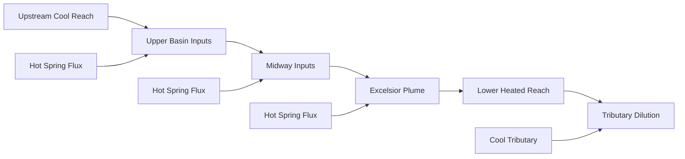

# Yellowstone **Hydro-Thermal** Simulation Report

This report covers the **physical system**, governing equations and parameters, measurement gaps and validation, and habitat-refuge linkages for a Yellowstone Firehole thermal-river simulation. The literature supports a reach-scale, process-based model in which **advective mixing** dominates geothermal inputs and tributary confluences, while atmospheric and bed exchanges set downstream cooling and persistence of thermal plumes (Carraro et al., 2019; Leach et al., 2023; Smith & Kurylyk, 2024).

## Physical System

The Firehole River is a natural analog of long-term thermal loading, with river temperature raised by about 10.5–16°C through the main geyser basins and locally reaching about 28.8–30°C in summer (Zeikus & Brock, 1972; Kaya et al., 1977; Goldstein et al., 2001). Geothermal inflows can contribute up to 40% of total discharge outside spring runoff, so a six-reach chain should treat hot-spring additions as explicit internal source terms rather than small perturbations (Goldstein et al., 2001; Brock, 1978).

A practical six-reach representation is: upstream cool mainstem, Upper Geyser Basin loading, Midway basin loading, Excelsior plume reach, lower heated mainstem, and cool-tributary dilution/recovery reach. This discretization matches literature showing that river-network temperature is well represented by connected, well-mixed reaches linked by an adjacency structure, with explicit lateral inflows and nonadvective heat exchange at each reach (Carraro et al., 2019).

The Excelsior feature is best conceptualized as a localized hot-source plume embedded in the broader heated mainstem, because refuge and plume studies show that discharge, source temperature, ambient flow, and flow-deflecting geometry strongly control plume extent and mixing footprint (Smith & Kurylyk, 2024). Tributary dilution should be treated explicitly at confluences because cool tributaries in the Firehole function as refuges when nearby mainstem temperatures exceed about 24–25°C, implying biologically important thermal contrasts over short distances (Kaya et al., 1977; Kaeding, 1996).

**Six-Reach Thermal Mixing Scheme**

**Figure 1:** Six-reach Firehole thermal loading and dilution scheme

- **Mainstem heating** is gradual but strong through geothermal basins (Zeikus & Brock, 1972).
- **Geothermal discharge fraction** can be large enough to dominate summer heat budgets (Goldstein et al., 2001).
- **Cool tributaries** create short-scale thermal contrasts used by trout during hot periods (Kaya et al., 1977; Kaeding, 1996).

## Governing Equations

The core reach equation is a water-energy balance on each well-mixed control volume, consistent with network temperature models and integrated compartment formulations (Carraro et al., 2019; Miller & Young, 2021). For reach \(i\),

\[
\frac{d(V_i T_i)}{dt}
=
\sum_{j} Q_{ji} T_j
+
Q_{\mathrm{hot},i} T_{\mathrm{hot},i}
-
Q_{\mathrm{out},i} T_i
+
V_i \frac{(T_{\mathrm{air},i}-T_i)}{\tau_i}.
\]

The first three terms are advective heat transport by upstream inflows, geothermal inputs, and downstream export; the last term is a lumped air-water-plus-bed exchange term written in Newton-cooling form, consistent with equilibrium-temperature and integrated heat-flux approaches (Carraro et al., 2019; Dorthe et al., 2025).

The constant-volume constraint for each substep is

\[
Q_{\mathrm{out},i}=\sum_j Q_{ji}+Q_{\mathrm{hot},i}+Q_{L,i},
\]

with \(Q_{L,i}=0\) when no other lateral inflow is assigned. This follows reach water-budget formulations in which outflow, storage, and lateral inflows are balanced explicitly (Carraro et al., 2019; Miller & Young, 2021).

Instantaneous mixing at a confluence or source junction is

\[
T_{\mathrm{mixed}}=\frac{Q_1T_1+Q_2T_2}{Q_1+Q_2},
\]

which is the appropriate limit when the receiving control volume is assumed fully mixed (Carraro et al., 2019; Miller & Young, 2021). For a one-dimensional downstream thermal relaxation profile under approximately steady discharge and net exchange proportional to \(T-T_a\),

\[
T(x)=T_a+\left(T_0-T_a\right)\exp\!\left(-\frac{h_e b x}{\rho c_p Q}\right),
\]

which is the steady spatial form of the standard 1-D heat advection framework when dispersion is neglected or secondary (Dugdale et al., 2017; Miller & Young, 2021).

For explicit time stepping of a linear cooling tendency \(dT/dt=-\mathrm{rate}\,(T-T_a)\), the stability condition \(dt \le 0.45/\mathrm{rate}\) is a conservative implementation choice for substepping fast exchange terms. That choice is consistent with the literature’s emphasis that sub-hourly to daily thermal dynamics can be sensitive to timestep and process representation, especially when sharp forcing or strong sediment exchange is present (Dorthe et al., 2025).

## Parameters

Key simulation parameters can be divided into geometry, flow and source terms, exchange terms, and habitat-response terms. Process-based studies agree that morphology, discharge, lateral inflow temperature, solar exposure, and sediment exchange are the main inputs controlling performance (Carraro et al., 2019; Dorthe et al., 2025).

Representative Parameters

| Parameter | Value | Units | Status | Source Basis | Citation URL |
|---|---:|---|---|---|---|
| Mainstem geothermal warming | 10.5 to 16 | °C above cool reach | Illustrative | Firehole observations | paper (Carraro et al., 2019), (Leach et al., 2023) |
| Summer lower-river maximum | 28.8 to 30 | °C | Illustrative | Firehole observations | paper (Smith & Kurylyk, 2024), (Zeikus & Brock, 1972) |
| Geothermal share of discharge | up to 40 | % of total flow | Illustrative | Outside spring runoff | paper (Zeikus & Brock, 1972) |
| Trout refuge trigger | mean >24 or max >25 | °C | Illustrative ecological threshold | Firehole refuge use | paper (Smith & Kurylyk, 2024) |
| Brown trout limit reference | 20 | °C | Illustrative habitat threshold | Salmonid threshold example | paper (Kaya et al., 1977) |

**Figure 2:** Illustrative thermal and habitat parameters for Firehole simulation

Model Structure Parameters

| Parameter | Value | Units | Status | Source Basis | Citation URL |
|---|---:|---|---|---|---|
| \(V_i\) reach volume | unknown by reach | m³ | Unknown | Requires bathymetry/cross sections | paper (Goldstein et al., 2001) |
| \(Q_{ji}\) upstream inflow | time series | m³ s\(^{-1}\) | Unknown | Reach routing input | paper (Goldstein et al., 2001) |
| \(Q_{\mathrm{hot},i}\) hot-source inflow | time series | m³ s\(^{-1}\) | Unknown | Geothermal branch/source discharge | paper (Goldstein et al., 2001) |
| \(T_{\mathrm{hot},i}\) hot-source temperature | time series | °C | Unknown | Geothermal boundary temperature | paper (Goldstein et al., 2001) |
| \(\tau_i\) exchange timescale | calibrated | time | Calibrated | Lumped air-water-bed cooling | paper (Goldstein et al., 2001), (Brock, 1978) |

**Figure 3:** Core physical parameters required by the reach model

## Missing Measurements

The largest gaps are **bathymetry and width-depth data**, **dated temperature and discharge series**, and **branch-specific geothermal inflows**. Process-based river models require morphology, reach width, discharge, and spatially distributed temperatures to estimate storage, exposure area, and heat exchange; lacking these, calibration absorbs unresolved physics and weakens transferability (Carraro et al., 2019; Dorthe et al., 2025).

Bed temperature, salinity or geochemistry, and hyporheic properties are also important because streambed exchange can materially improve model performance and geothermal inflows in the Firehole are chemically distinctive. Sediment-water heat exchange, shading, and unresolved advective bed processes repeatedly emerge as important corrections in recent temperature models (Dorthe et al., 2025; Miller & Young, 2021; Goldstein et al., 2001).

- Missing **bathymetry** blocks reliable \(V_i\), wetted width \(b\), and residence-time estimates (Carraro et al., 2019; Miller & Young, 2021).
- Missing **dated T/Q series** prevents calibration of exchange and validation of diel dynamics (Dorthe et al., 2025).
- Missing **bed and soil properties** obscures sediment exchange and hyporheic thermal inertia (Miller & Young, 2021; Dorthe et al., 2025).

## Validation And Habitat Links

Validation should enforce strict conservation and physical realism before ecological interpretation. Reach-network studies support checking water and energy budgets explicitly, while field-based refuge studies show that ecologically relevant realism also includes spatial plume structure and confluence temperature contrasts (Carraro et al., 2019; Smith & Kurylyk, 2024; Wilbur et al., 2020).

Recommended criteria are: volume conservation below \(10^{-9}\,\mathrm{m}^3\) per step, heat residual near \(10^{-10}\,\mathrm{m}^3\,^\circ\mathrm{C}\), monotone downstream cooling in the absence of new hot inputs, and plume-geometry verification near major sources such as Excelsior against thermal imagery or mapped warm patches. Plume extent is especially sensitive to discharge, source temperature, and local mixing geometry (Smith & Kurylyk, 2024).

Thermal profile outputs can be linked to habitat suitability by refuge-occupancy functions rather than temperature alone. Fish do not use every thermal anomaly, and refuge value depends on area, depth, velocity, substrate, connectivity, and recent thermal history (Wilbur et al., 2020; Linnansaari et al., 2023). In the Firehole, trout aggregate in cool tributaries once mainstem temperatures exceed about 24–25°C, and abundance in tributaries rises exponentially with nearby mainstem temperature (Kaya et al., 1977; Kaeding, 1996). Population modeling further indicates that refuge area can become a summer bottleneck, with persistence under high warming improved when refuges occupy at least about 2% of stream area (Railsback & Harvey, 2023).

For the Yellowstone thermal-river simulation, the literature therefore supports a six-reach, well-mixed network model with explicit geothermal source terms, tributary dilution, and calibrated lumped heat exchange, while the biggest uncertainties remain geometry, time-resolved inflows, and bed-exchange data. Habitat linkage should treat simulated temperature plumes as necessary but not sufficient predictors of refuge use in the Firehole system.
 
_These search results were found and analyzed using Consensus, an AI-powered search engine for research. Try it at https://consensus.app. © 2026 Consensus NLP, Inc. Personal, non-commercial use only; redistribution requires copyright holders’ consent._
 
## References
 
Brock, T. D. (1978). The Firehole River. 419-440. https://doi.org/10.1007/978-1-4612-6284-8_13
 
Carraro, L., Toffolon, M., Rinaldo, A., & Bertuzzo, E. (2019). SESTET: A spatially explicit stream temperature model based on equilibrium temperature. *Hydrological Processes, 34*, 355 - 369. https://doi.org/10.1002/hyp.13591
 
Dorthe, D., Pfister, M., & Lane, S. (2025). Model Inputs and Data Requirements for Process‐Based Stream Temperature Modeling in Regulated Peri‐Alpine Rivers. *Water Resources Research, 61*. https://doi.org/10.1029/2024wr038860
 
Dugdale, S., Hannah, D., & Malcolm, I. (2017). River temperature modelling:: A review of process-based approaches and future directions. *Earth-Science Reviews, 175*, 97-113. https://doi.org/10.1016/j.earscirev.2017.10.009
 
Goldstein, J. N., Woodward, D., Farag, A., & Meyer, J. S. (2001). Naturalized salmonid populations occur in the presence of elevated trace element concentrations and temperatures in the firehole river, Yellowstone National Park, Wyoming, USA. *Environmental Toxicology and Chemistry, 20*. https://doi.org/10.1002/etc.5620201029
 
Kaeding, L. (1996). Summer Use of Coolwater Tributaries of a Geothermally Heated Stream by Rainbow and Brown Trout, Oncorhynchus mykiss and Salmo trutta. *American Midland Naturalist, 135*, 283-292. https://doi.org/10.2307/2426711
 
Kaya, C. M., Kaeding, L., & Burkhalter, D. (1977). Use of a Cold-Water Refuge by Rainbow and Brown Trout in a Geothermally Heated Stream. *The Progressive Fish-culturist, 39*, 37-39. https://doi.org/10.1577/1548-8659(1977)39[37:uoacrb]2.0.co;2
 
Leach, J. A., Kelleher, C., Kurylyk, B., Moore, R. D., & Neilson, B. (2023). A primer on stream temperature processes. *Wiley Interdisciplinary Reviews: Water, 10*. https://doi.org/10.1002/wat2.1643
 
Linnansaari, T., O'Sullivan, A., Breau, C., Corey, E., Collet, E. N., Curry, R. A., & Cunjak, R. (2023). The Role of Cold-Water Thermal Refuges for Stream Salmonids in a Changing Climate—Experiences from Atlantic Canada. *Fishes*. https://doi.org/10.3390/fishes8090471
 
Miller, R. L., & Young, T. (2021). Reduced‐complexity model of stream temperature. *River Research and Applications, 38*, 267 - 279. https://doi.org/10.1002/rra.3909
 
Railsback, S., & Harvey, B. (2023). Can thermal refuges save salmonids? Simulation of cold pool benefits to trout populations. *Transactions of the American Fisheries Society*. https://doi.org/10.1002/tafs.10411
 
Smith, K. A., & Kurylyk, B. (2024). Pumping Groundwater to Create Cold‐Water Thermal Refuges in Warming Rivers. *Ecohydrology, 18*. https://doi.org/10.1002/eco.2739
 
Wilbur, N., O'Sullivan, A., MacQuarrie, K., Linnansaari, T., & Curry, R. (2020). Characterizing physical habitat preferences and thermal refuge occupancy of brook trout (Salvelinus fontinalis) and Atlantic salmon (Salmo salar) at high river temperatures. *River Research and Applications, 36*, 769 - 783. https://doi.org/10.1002/rra.3570
 
Zeikus, J., & Brock, T. D. (1972). Effects of Thermal Additions from the Yellowstone Geyser Basins on the Bacteriology of the Firehole River. *Ecology, 53*, 1282-1291. https://doi.org/10.2307/1934083
 
