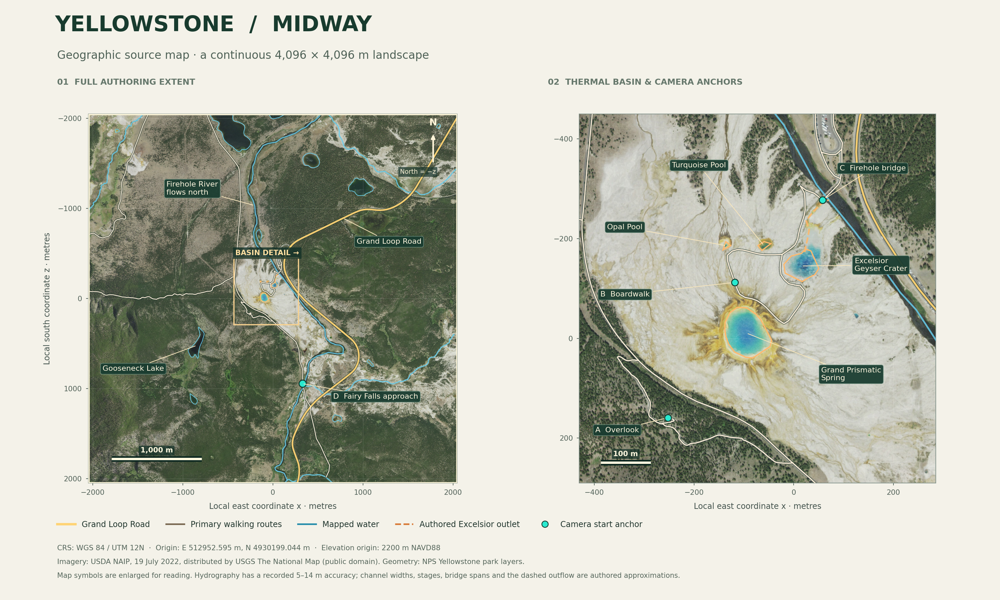

# Geographic research and the source landscape

## The selected place

The project covers a **4,096 × 4,096 metre square** around Midway Geyser Basin, an area of 16.777216 km². Grand Prismatic Spring, Excelsior Geyser Crater, the smaller named pools, the Firehole River, the adjacent Grand Loop Road, the Midway boardwalk, the southern Fairy Falls approach and the Grand Prismatic Overlook are within this continuous area. The surrounding forest, meadow, pond and thermal-ground pattern comes from the same geographic extent. Distances between attractions have not been compressed.

The segment was chosen because its recognizable features also reveal interacting systems: thermal discharge enters a river; cooler tributaries enter the same drainage; forest and wetland edges meet largely barren thermal deposits; the observation trail gains enough height to expose the basin's layout. NPS describes a 0.6-mile / approximately 966-metre approach and 105 feet / 32 metres of ascent from the Fairy Falls trailhead to the overlook. This is a useful independent scale check, not a reason to change surveyed trail vertices until the number matches exactly. [NPS overlook description](https://www.nps.gov/thingstodo/yell-trail-grand-prismatic-overlook.htm)

The full Fairy Falls destination and the rest of Yellowstone are **not** contained in this square. Named route segments ending at the crop edge are geographic continuations. They should acquire adjoining terrain as the project expands.

The map overlays the actual imported route and water geometry on the July 2022 NAIP imagery. Its four camera anchors correspond to the saved start locations; the dashed outlet is the explicitly authored Excelsior branch. Local axes and scale bars preserve the project coordinate contract. Enlarged line symbols make the topology readable and do not represent measured route or channel widths.

## Coordinate contract

| Property | Value |
|---|---:|
| Horizontal coordinate system | WGS 84 / UTM zone 12N, EPSG:32612 |
| Geographic origin | 44.525° N, 110.837° W |
| Origin easting | 512952.5950985841 m |
| Origin northing | 4930199.044097667 m |
| Vertical origin | 2200.0 m, NAVD88 |
| World x | Easting minus origin easting |
| World y | Source elevation minus 2200.0 m |
| World z | Origin northing minus northing; positive is south |
| World bounds | x and z both −2048 to +2048 m |
| Source grid | 1025 × 1025 sample centres, four metres apart |
| Raw float ordering | Little-endian float32; west to east within each row; north row first |

The local scene uses one Godot unit per projected metre. UTM is a metric map projection, not a claim of millimetre ground-survey accuracy. Preserve the same origin and projection for every later tile, road, prop, habitat polygon and water graph. Do not independently centre each imported asset. The decimal places above make transformations reproducible; they do not increase the accuracy of the original measurement.

`references/terrain_source.f32` contains **absolute** source elevations. `data/terrain.f32` contains authored local elevations after subtracting the vertical origin and applying the documented water and road integration. The retained GeoTIFF is the unmodified terrain reference. The DEM is not a bathymetric survey: dark water, hot-spring depth and submerged channel cross-sections cannot be reconstructed by reading its height values.

## What was actually downloaded

The project includes real source data, rather than requiring the reader to locate every dataset later. `references/geodata_manifest.json`, the per-image provenance files, `terrain_source.json`, `dem_download.json` and the source catalog responses record coordinates, URLs and checksums.

| Included source | What it supplies | Date and accuracy limits |
|---|---|---|
| `dem.tif`, `terrain_source.f32` | USGS 3DEP bare-earth elevation exported as floating-point metres | The selected area has the native one-metre `WY_YellowstoneNP_2020_D20` tiles `x51y493` and `x51y494`; catalog acquisition interval is September 2020 through July 2022. The exported grid is four metres. |
| `orthophoto.jpg` | Entire extent, 2048² RGB image, two-metre export pixels | USDA NAIP imagery acquired **July 19, 2022**, with native 0.6-metre resolution. |
| `midway_orthophoto_detail.jpg` | Central 1280-metre square, 2048² RGB image | Same source imagery, exported at 0.625 metre per pixel for water-margin and boardwalk reference. |
| `yell_roads_utm12.json` | NPS Grand Loop Road and associated access/parking centre lines | Horizontal accuracy is recorded as unknown for these road features. Widths and cross-sections are authored. |
| `yell_trails_utm12.json` | NPS named trail and boardwalk centre lines and surface attributes | Many segments state 1–5 m accuracy. The 2017 Trimble Geo7X Grand Prismatic Overlook segments state 5–50 cm. Some other segments state 5–14 m. |
| `yell_hydro_rivers_utm12.json` | Firehole, Fairy, White, Rabbit and Mallard drainage centre lines | Derived from older USGS digital line graphs; the features state 5–14 m horizontal accuracy. They supply alignments, not surveyed banks or water levels. |
| `yell_hydro_lakes_utm12.json` | Mapped water-body polygons | The same older-source, 5–14 m accuracy limitation applies. Several hot-spring polygons have blank names and require explicit identification. |
| `yell_points_of_interest_utm12.json` | Trailheads, exhibits and a bridge point | Each feature retains its own source and accuracy attributes. A label point is not necessarily a safe or exact player spawn. |
| `yell_veg_land_cover_utm12.json`, `yell_soils_utm12.json` | Broad land-cover and soil context | These are research inputs. Broad forest or soil polygons do not resolve individual trees, small wetland edges or current hydrothermal boundaries. |

The full 3DEP export uses the service's default mosaic. Its origin pixel was independently checked against an explicitly locked native one-metre source and matched exactly. Native one-metre coverage is identified across the extent in `dem_area_catalog.json`. Preserve that distinction: the current retained raster is reproducible from its checksum; a future default-service export may choose different source rasters. Do not silently replace it during a normal build. The service documents floating-point elevation, analysis/export support and its changing publication inventory. [USGS 3DEP service](https://elevation.nationalmap.gov/arcgis/rest/services/3DEPElevation/ImageServer)

The national NPS road/trail extracts were obtained first. The more detailed park-specific `yell_*` files are the authoring inputs, including the separately named overlook trail. In particular, the Fountain Freight Service Road layer overlaps the Fairy Falls alignment. The compiler avoids drawing a duplicate paved route over that trail.

### Imagery permission and credits

The resolved Wyoming source tiles are USDA NAIP, not a commercial satellite basemap. The USGS NAIP service explicitly describes these images as public-domain orthoimagery, and the export service permits copying and analysis. A useful credit is:

> USDA NAIP 2022, distributed by USGS The National Map; public domain. Reprojected and resampled for this project.

The service's own credit is “USGS, USDA, The National Map: Orthoimagery.” The service publication date is different from the photograph's acquisition date. Retain the **2022-07-19** acquisition date and the two resolved tile names from `imagery_source_catalog.json`. [USGS NAIP service](https://imagery.nationalmap.gov/arcgis/rest/services/USGSNAIPImagery/ImageServer) · [USGS NAIP Plus export service](https://imagery.nationalmap.gov/arcgis/rest/services/USGSNAIPPlus/ImageServer)

NAIP is appropriate as a geographic reference and distant colour layer. It contains tree crowns, their shadows, vehicles and lighting from one particular flight. It is not a clean ground-colour material. A finished close-view landscape needs manually corrected ground textures under three-dimensional trees, removal of baked traffic, matched material transitions and seasonal alternatives. The USGS describes NAIP's orthorectification, source projection, acquisition practice and positional accuracy; a 0.6-metre pixel is not a guarantee of 0.6-metre absolute location accuracy. [USGS EROS NAIP overview](https://www.usgs.gov/centers/eros/science/usgs-eros-archive-aerial-photography-national-agriculture-imagery-program-naip)

## Landmarks and the difference between a pool and its deposit

`references/geoanchors.json` records reproducible landmark positions. For the springs, these are the centroids of the retained mapped water polygons, with manual identification made explicit. They are not asserted as a surveyed vent location.

| Landmark | Source water polygon ID | Local x, z, metres | Interpretation |
|---|---:|---:|---|
| Grand Prismatic Spring | 1034 | −94.707, −10.608 | Mapped water footprint; the coloured apron extends considerably beyond it. |
| Excelsior Geyser Crater | 1030 | 15.812, −145.302 | Older mapped water footprint; it is not the whole crater and outflow area. |
| Turquoise Pool | 1028 | −59.872, −186.362 | Spatially identified from its location east of Opal. |
| Opal Pool | 1029 | −134.807, −185.866 | Spatially identified smaller western pool. |
| Grand Prismatic overlook deck approach | Trail 3455 endpoint | Approximately −251.95, 159.44 | Source trail endpoint; a deck still needs separately authored dimensions and height. |

NPS describes Grand Prismatic as 200–330 feet across and over 121 feet deep. This is approximately 61–101 metres across and over 37 metres deep, consistent with a large spring rather than a kilometre-wide lake. The imported water polygon's bounding dimensions are approximately 94 × 102 metres. Preserve its asymmetric footprint and the drainage fingers around it. A perfect circle with concentric rainbow bands would lose the geographic character. [NPS Grand Prismatic Spring](https://www.nps.gov/places/000/grand-prismatic-spring.htm)

NPS describes the Excelsior crater as 200 × 300 feet, approximately 61 × 91 metres, and reports continuous discharge exceeding 4,000 US gallons per minute into the Firehole. That description covers a crater and active drainage, while the old mapped open-water polygon is smaller. Model crater bank, pool, steam-obscured margin and outflow as related but distinct authored surfaces. [NPS Excelsior Geyser Crater](https://www.nps.gov/places/000/excelsior-geyser-crater.htm)

## Drainage and thermal coupling

The Firehole flows **north** here. A USGS account of combined thermal imagery and LiDAR explains that the river passes between the Biscuit Basin and West Yellowstone lava flows. Its reported 15–30°C change over about two kilometres describes observations associated with that study, not a universal year-round temperature profile. The useful implementation relationship is that spring discharge changes downstream river temperature and chemistry, while tributary flow and atmospheric exchange change those conditions again. [USGS thermal-imagery and LiDAR study explanation](https://www.usgs.gov/observatories/yvo/news/new-technologies-help-characterize-hydrothermal-activity-yellowstone)

The authoring compiler therefore treats joined river segments as a connected profile. Mainstem heights are fitted together with a decreasing least-squares constraint, tributary outlets share confluence heights, and source terrain remains separately available. This removes the artificial waterfalls caused by smoothing and clamping each segment independently. The resulting water stage remains an **authored approximation**. It has not been calibrated with gauges or cross-section surveys.

The four-metre master grid cannot resolve a two-to-three-metre channel simply by lowering the samples directly under the water. A visible water ribbon is supported by terrain triangles whose corner samples lie outside that ribbon. The current compiler therefore lowers a support band extending **six metres beyond each visual half-width**, with a further blend to the original bank terrain. Overlapping constraints take their lowest water-compatible height, and both road-grading passes preserve those support vertices. The actual river alignment and rendered width remain unchanged. These broad, approximate support banks should be replaced with locally refined hand-authored channel meshes for close-view work. Independent sampling after final grading checked 78,083 points across the rendered ribbon widths using the same triangle diagonal as the visible terrain and Godot's HeightMap collision: none were buried, and minimum water-to-terrain clearance was 0.12 metre. `references/channel_support_qa.json` retains the per-channel results.

`excelsior_outflow_trace.json` records one representative outflow alignment traced against the 2022 aerial. Its start joins the authored pool level and its end joins an existing Firehole centre-line vertex. The 0.252 m³/s value corresponds approximately to the NPS aggregate lower bound, assigned here as an illustrative system parameter. It does not establish the measured discharge of that individual branch. The actual system has multiple distributaries. Steam also obscures some of the source margin.

Thermal ground should be a habitat exclusion and transition layer, not simply a painted orange zone. USGS's thermal-area release distinguishes hydrothermally altered ground, mineral deposits, heated ground, gas emissions and thermal water bodies; those boundaries can change over time. Use the release for a later carefully dated thermal mask and retain its CC0 attribution. Its downloadable dataset was identified during research but was not successfully downloaded into this source pack. [USGS thermal-area release, updated December 2023](https://www.usgs.gov/data/map-yellowstones-thermal-areas-updated-2023-12-31)

## Hand-authoring tolerances and seam rules

These are project acceptance targets, rather than accuracy claims about NPS or USGS data:

1. **Terrain tiles:** neighbouring tiles share the same samples at their borders. Compute normals from the same global field, including a one-sample halo. A shared vertex should have identical position and normal, not two close approximations hidden by a skirt.
2. **Routes:** join matching source endpoints once, use a common height, and make small elevation corrections through smooth approach ramps. The compiler uses a 0.75-metre endpoint clustering tolerance; it does not snap arbitrary nearby path interiors together.
3. **River confluences:** all incoming and outgoing segments share their junction level. Preserve mainstem direction through every subdivision. Separate surface normals, banks and material transitions still need an explicit junction mesh where narrow tributaries enter a wider river.
4. **Crossings:** a boardwalk or bridge is an elevated structure. Do not raise an embankment across the river merely to put a walking collision surface under it. Deck, supports, underside, handrails and collision are independent authored components.
5. **Water margins:** old water polygons can be several metres off relative to current imagery. Keep the source unchanged, record shoreline edits as an authored revision, and inspect from eye height as well as from the orthophoto. Do not claim sub-metre fidelity because the mesh has many vertices.
6. **Placement:** broad cover classification can propose a frozen layout, but actual hero trees, shoreline vegetation, logs, flowers and exposed mineral margins need individual review. Keep roots out of the road, boardwalk footprint, open water and active thermal ground.
7. **Visual and collision agreement:** player contact height comes from the same authored terrain and route profile shown by the mesh. Test joins while walking across them, including low frame rates and shallow approach angles.

## Repeating the geographic import

Use the saved service URLs in `geodata_manifest.json` and query the new metric bounding box with `inSR=32612`, `outSR=32612`, `returnGeometry=true` and the required attributes. An ArcGIS intersection query returns entire intersecting features; it does not clip their geometry to the box. Clip only after projecting into the shared local frame, preserving feature IDs and multipart structure.

For a 1025-node height grid at four-metre pitch, the actual mesh span is 4096 metres. An image export instead describes pixel **edges**. Request a 4100-metre extent, extending two metres beyond the outer sample centres on each side, so the 1025 pixel centres fall exactly on the required nodes. Keep this half-cell convention explicit when writing the GeoTIFF and the raw float file.

Validate both the response format and the data before importing. An HTTP success response or an image content-type header can still contain an ArcGIS JSON error. The first oversized aerial request in this session did exactly that; the retained image was replaced with a decoded, inspected image at a supported size. Check CRS, affine transform, dimensions, finite elevation values, plausible elevation range and checksum. A new release should also record which source raster IDs were selected.

## Geographic expansion prompts

### Continue the same valley

> Extend the Midway project with adjacent integer-indexed terrain tiles using its existing UTM origin, NAVD88 offset and four-metre source grid. Continue the actual Grand Loop Road and Firehole graph across shared border ports. Preserve every existing authored placement unless a specifically listed correction is necessary. Retain the source survey and imagery dates, create a before/after map of changed geography, and verify route and water continuity before adding new scenery.

### Add Fairy Falls and its approach

> Extend westward from the existing Fairy Falls route to the actual waterfall, retaining its true distance and elevation. Obtain appropriate elevation and dated photography, author the cliff and waterfall as hero geometry, and connect the upstream stream, lip, falling water, plunge pool and downstream reach. Do not resize the destination to fit the present four-kilometre square. State where the source DEM cannot resolve an overhang or narrow channel.

### Replace the basin's approximate details

> Review the retained 0.625-metre Midway aerial, NPS trail surveys and current dated photographs. Hand-author the boardwalk junctions, bridge, overlook, crater banks and each thermal distributary. Keep geographic centre lines as reference constraints while recording all visual corrections separately. Remove baked aerial shadows beneath three-dimensional trees. Split aggregate Excelsior discharge over a measured or explicitly approximate channel network, enforce water and heat conservation, and label calibration status in the authoring inspector.

### Expand north or south to another developed basin

> Select the next contiguous road and river segment geographically. Fetch new reference imagery for an explicitly chosen year before authoring thermal terrain, since hydrothermal features and infrastructure can change. Continue existing materials and vegetation transition zones across the boundary, but build the new basin's shape, deposits, drainage and species pattern from its own sources. Keep the old scene origin and world scale unchanged.
